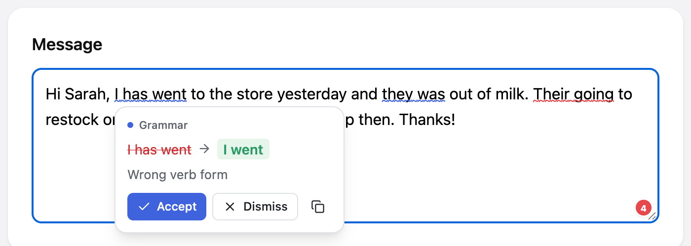
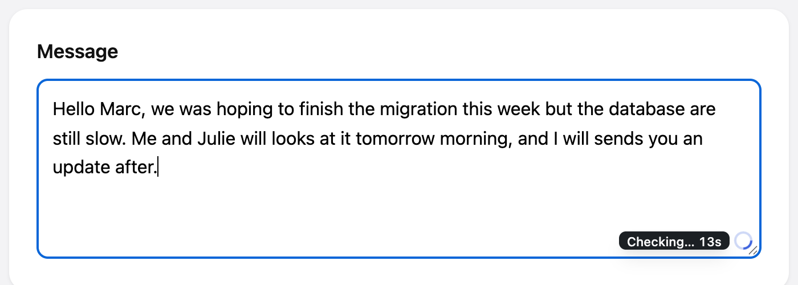
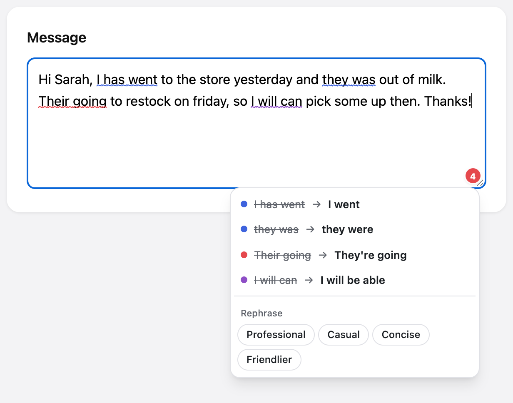
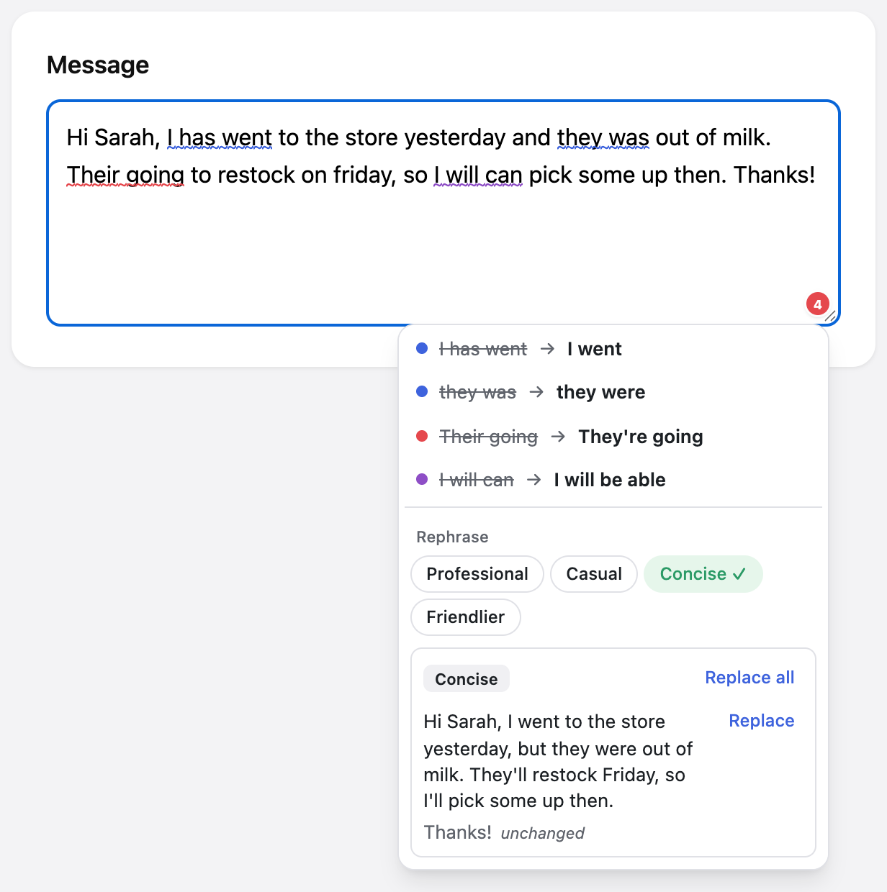

<!-- prettier-ignore -->
<div align="center">

# Grammar Checker

*Grammar and spelling checks in English and French, powered by the LLM you choose, local or cloud*

[Features](#features) • [Getting started](#getting-started) • [Usage](#usage) • [Configuration](#configuration) • [Project structure](#project-structure)



</div>

A grammar and spelling checker for macOS, in English and standard French. A Chrome extension (and later a Swift menu-bar helper) sends the text you type to a local Bun/TypeScript core. The core calls any OpenAI-compatible LLM, local (e.g. Ollama) or cloud, and returns issues with exact text offsets, so they can be underlined right where you wrote them.

> [!NOTE]
> The core and the Chrome extension work today. The macOS menu-bar app, for checks in native apps such as Notes, Mail and TextEdit, is planned but not started yet. See the [milestones](docs/spec.md#milestones--open-questions).

## Features

- **Inline underlines**: in `input`, `textarea` and `contenteditable` fields, coloured by type (spelling red, grammar blue, punctuation orange, syntax purple).
- **Suggestion card**: accept a fix, dismiss it, add a word to your dictionary, or copy the suggestion when a rich editor won't take the edit.
- **Field badge**: an issue count in the corner of the focused field; click it to list every issue.
- **Rephrase**: on demand, pick a tone (Professional, Casual, Concise, Friendlier) and get that version of the paragraph at the caret; add more tones to compare, with Replace and Replace all.
- **Personal dictionary**: terms you add are never flagged, and the model is told about them so it doesn't "correct" them.
- **Any OpenAI-compatible model**: Ollama, LM Studio, llama.cpp or a cloud API, for English, French and mixed text.
- **Private by design**: the core listens on `127.0.0.1` only, behind a per-install token; password fields are never read, and text, prompts and model replies are never logged.

## Getting started

### Prerequisites

- [Bun](https://bun.sh/) (the repo is developed with Bun 1.4)
- [Ollama](https://ollama.com/) with `qwen3:8b` pulled, or any other OpenAI-compatible endpoint
- Google Chrome, to load the extension

### Run it locally (Chrome)

1. Clone the repo and install dependencies:

   ```bash
   git clone https://github.com/vicodut/speller-check.git
   cd speller-check
   bun install
   ```

2. Pull the default model (skip this if you use another provider):

   ```bash
   ollama pull qwen3:8b
   ```

3. Start the core. It starts Ollama if it isn't running, then serves on `127.0.0.1:7341`. Ctrl-C stops both:

   ```bash
   bun run dev
   ```

4. In another terminal, print the install token (it's created on first use). You can also copy it, or generate a new one, from the **Chrome extension** section of the settings page (`bun run settings`):

   ```bash
   bun run --cwd apps/core cli token
   ```

5. Build the extension:

   ```bash
   bun run build:chrome
   ```

6. Open `chrome://extensions`, turn on **Developer mode**, click **Load unpacked** and pick `apps/chrome/dist`. Open the extension's **Options** page, paste the token and save. The status card at the top should turn green and read **Connected**, with the model and a Local or Cloud badge.

> [!TIP]
> After rebuilding the extension, reload it in `chrome://extensions`, then reload the tabs that were already open.

### Use a prebuilt build

The **Build** workflow packages everything on `main`, on manual runs and on `v*` tags (as a GitHub release):

- `grammar-checker-extension.zip`: unzip it, then **Load unpacked** the folder in `chrome://extensions`.
- `grammar-checker-core-arm64.tar.gz` (Apple silicon) or `-x64.tar.gz` (Intel): the core as one binary, with its settings page beside it. Unpack it and run `./gc-core serve` (the `GC_*` variables below apply), then `./gc-core token` for the extension. The binary is ad-hoc signed only: if macOS blocks it, run `xattr -d com.apple.quarantine gc-core`.

Build the same files locally with `bun run package:extension` and `bun run package:core arm64` (or `x64`); they land in `out/`.

## Usage

Focus any text field in Chrome and type. Underlines appear about a second after you stop. Click one to open its card, or click the badge to list every issue and reach the **Rephrase** tone buttons.

While a check runs, the badge is a spinner. Hover it to see how long the check has been running, so on a slow local model you can tell a long check from a stuck one:



<table>
<tr>
<td></td>
<td></td>
</tr>
<tr>
<td align="center">Every issue in the field, from the badge</td>
<td align="center">Rephrase in the tone you pick, here Concise</td>
</tr>
</table>

The core also has a small CLI (`bun run --cwd apps/core cli` with no command prints its help).

**Check text from stdin and print the issues as JSON:**

```bash
echo "I has went to the store." | \
  GC_BASE_URL=http://127.0.0.1:11434/v1 GC_MODEL=qwen3:8b GC_REASONING_EFFORT=none \
  bun run --cwd apps/core cli check
```

Each issue has `original`, `suggestion`, `reason`, `context`, `type` (`grammar`, `spelling`, `syntax` or `punctuation`) and its `start`/`end` offsets in the text.

**Run the WebSocket server without the dev launcher:**

```bash
GC_BASE_URL=http://127.0.0.1:11434/v1 GC_MODEL=qwen3:8b bun run --cwd apps/core cli serve
```

## Configuration

The core is configured with environment variables. `bun run dev` fills in the Ollama defaults below; `cli check` and `cli serve` need `GC_BASE_URL` and `GC_MODEL` set explicitly.

| Variable | Default | Description |
| --- | --- | --- |
| `GC_BASE_URL` | `http://127.0.0.1:11434/v1` (with `bun run dev`) | OpenAI-compatible base URL, including the version prefix. `bun run dev` only starts Ollama when it points there. |
| `GC_MODEL` | `qwen3:8b` (with `bun run dev`) | Model name sent to the endpoint. |
| `GC_API_KEY` | none | API key for cloud providers. Not needed for local models. |
| `GC_REASONING_EFFORT` | `none` (with `bun run dev` and the default model) | `none`, `low`, `medium` or `high`. `none` turns thinking off on models like qwen3. |
| `GC_DICTIONARY_PATH` | `~/Library/Application Support/GrammarChecker/dictionary.json` | Your personal dictionary. |
| `GC_PORT` | `7341` | WebSocket port on `127.0.0.1`. If you change it, change it in the extension's Options too. |
| `GC_TOKEN_PATH` | `~/Library/Application Support/GrammarChecker/token` | Where the install token is kept. |
| `GC_SETTINGS_PAGE_DIR` | `settings/` beside a packaged binary, `apps/settings-web/dist` from source | Where `serve` finds the built settings page. |

> [!WARNING]
> With a cloud provider, the text you type leaves your machine and goes to that provider. Keep your API key in the environment, never in a file inside this repo.

The dictionary is a JSON file; a missing file counts as empty. Entries are case-sensitive unless you set `caseInsensitive`:

```json
{
  "entries": [
    { "term": "NestJS", "note": "framework name" },
    { "term": "Ollama", "caseInsensitive": true }
  ]
}
```

The extension's Options page also has a **site blocklist** (one hostname per line, subdomains included): the extension reads nothing on those sites.

## Project structure

| Path | What it is |
| --- | --- |
| [`apps/core`](apps/core) | Bun/TS core: providers, check pipeline, rephrase, dictionary, settings, WebSocket server and CLI |
| [`apps/chrome`](apps/chrome) | Chrome extension (Manifest V3, TypeScript, React for the card and options page) |
| [`apps/settings-web`](apps/settings-web) | The settings page the core serves at `/settings` (React, Tailwind) |
| [`apps/mac`](apps/mac) | Swift menu-bar app (planned) |
| [`packages/protocol`](packages/protocol) | Zod schemas, the single source of truth for every message and model output |
| [`packages/ui`](packages/ui) | Shared palette and shadcn-style components; generates the theme CSS for the pages and the injected UI |
| [`scripts`](scripts) | `dev.ts` (the `bun run dev` launcher) and the packaging scripts used by CI |
| [`.github/workflows`](.github/workflows) | CI (`bun run check`) and the Build workflow (extension zip, core binaries) |
| [`docs`](docs) | Product spec and decisions log |

## Development

From the repo root:

```bash
bun run typecheck   # tsc -b
bun run lint        # Biome
bun test            # unit tests, no model needed
bun run check       # all three
```

`bun install` also runs `bun run generate`, which writes the theme files from `packages/ui/src/tokens/palette.ts` (`*.generated.*`, gitignored). Typecheck, tests and every build run it again, so change colours in the palette only.

**Score a model against the EN/FR fixtures** (opt-in; calls the model set by the `GC_*` variables):

```bash
GC_BASE_URL=http://127.0.0.1:11434/v1 GC_MODEL=qwen3:8b GC_REASONING_EFFORT=none bun run test:models
```

## Resources

- [Product spec](docs/spec.md): architecture, checking pipeline, protocol, UX and privacy rules
- [Decisions log](docs/decisions.md): a dated record of what changed and why, with model timings
- [`AGENTS.md`](AGENTS.md): code conventions (each app has its own as well)
